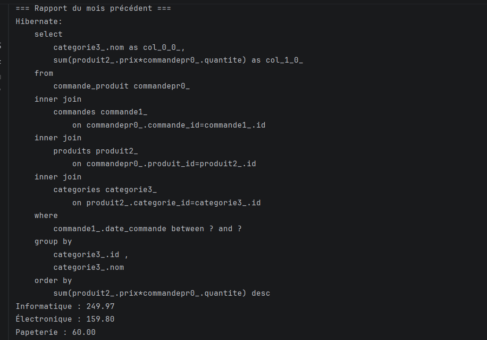
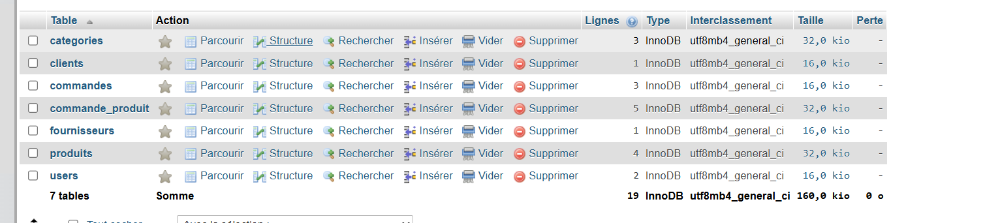

## Résultats

### Image 1 — Rapport des ventes

Chiffre d'affaires par catégorie pour les commandes du mois précédent, calculé avec la Criteria API.

### Image 2 — Tables de la base de données

Tables générées automatiquement par Hibernate dans MySQL à partir des entités JPA.